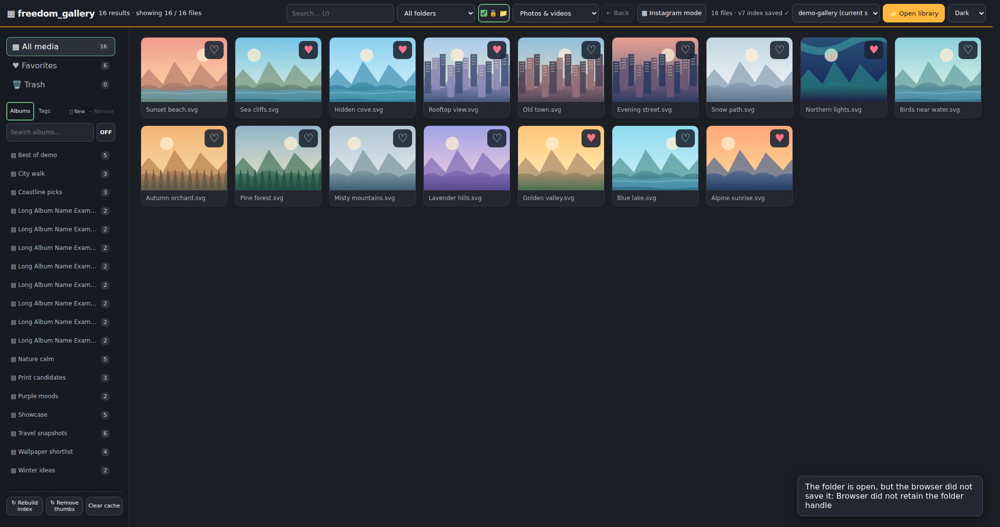
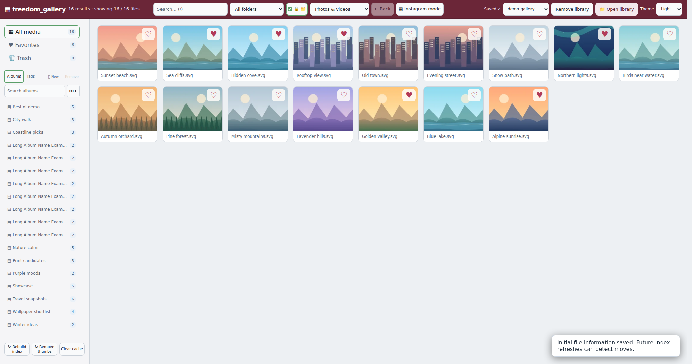
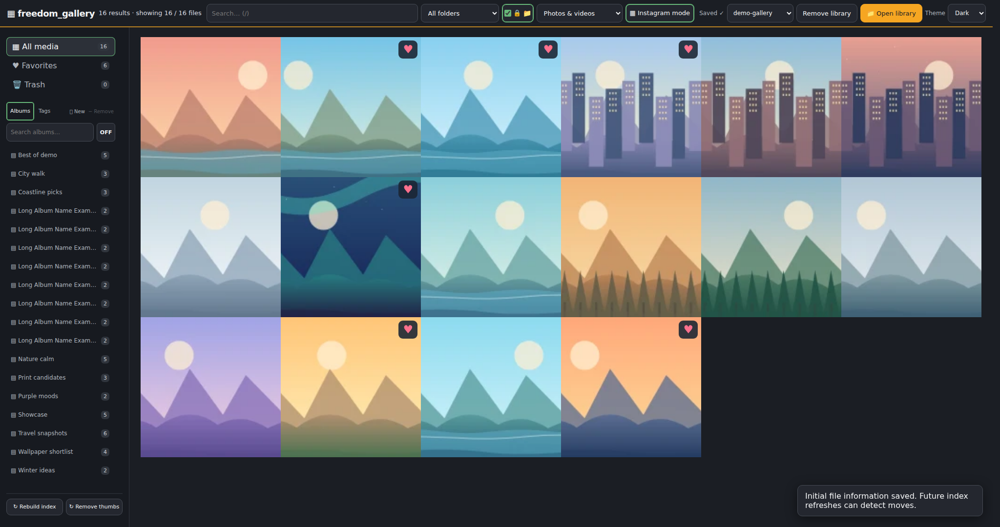
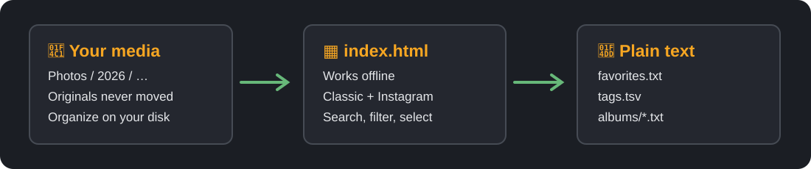

<div align="center">

# freedom_gallery

**Current version: v7.9.3**

**Your pictures. Your folders. Your freedom.**

A portable, private photo and video gallery that runs directly from one local HTML file.
Browse thousands of files, build albums and tags, and keep ownership of your original media.

[**Download a clean ZIP**](https://github.com/nibage/freedom_gallery/actions/workflows/build.yml) · [Tagged releases](https://github.com/nibage/freedom_gallery/releases) · [Explore the demo](#try-the-demo) · [Technical documentation](#technical-documentation)

</div>

## Made for the library you already have

| 📁 No lock-in | 📴 Works offline | 🏷️ Organize at scale | 🌗 Yours to customize |
| :-- | :-- | :-- | :-- |
| Leave photos and videos in their existing directories. | No server, cloud account, database, or upload. | Favorites, reusable tags, virtual albums, and fast filters. | Light/dark themes, Classic and Instagram layouts, keyboard shortcuts. |

### Screenshots — v7.9.3

These screenshots show the **actual current application**, captured automatically in Chromium at **2048 × 1080** using the included fictional demo library. No personal photos are used.

| Dark mode | Light mode | Instagram mode |
| :--: | :--: | :--: |
|  |  |  |
| Charcoal interface and warm orange accents. | Light interface with burgundy accents. | Edge-to-edge, square photo tiles in the dark theme. |

All three screenshots show the current gallery's compact single-row header, with its results count, search, folder/type filters, library controls and Theme selector.

### Latest release highlights

**v7.9.3** retains the compact widescreen header and fixes the recent-library dropdown: your currently opened folder is displayed immediately, even if browser storage fails. The last folder can reopen automatically when permission is already granted. If browser storage or filesystem permission is unavailable, the app now explains why it cannot reopen the folder and provides a reconnect path.

### See how it works



**1. Open a folder.** Point the gallery at your Pictures directory. Its index is saved locally, so subsequent visits reuse it.

**2. Find what matters.** Search by filename/path/tag, select folders, choose photos or videos, and combine album/tag filters with **OFF / OR / AND** and the **Fix folder** lock.

**3. Curate without copying.** Mark favorites, assign multiple tags, and collect files into albums. Undo one recent metadata action with **Ctrl+Z / Cmd+Z**.

**4. Take everything with you.** Move the library to a different computer or disk; your relative-path metadata stays beside your media.

### Try the demo

The [source repository](https://github.com/nibage/freedom_gallery) and the separately packaged **demo ZIP** include 16 original SVG sample pictures, preset tags, favorites, and albums. Open `__gallery/index.html` in **Chrome or Edge** and select the `demo-gallery` folder. You can test the UI without exposing your real collection.

---

# Technical documentation

## Install and download

For your actual photo library, download the **clean application ZIP** from a [GitHub Actions build](https://github.com/nibage/freedom_gallery/actions/workflows/build.yml) or a [tagged GitHub release](https://github.com/nibage/freedom_gallery/releases). Extract the `__gallery/` folder into the root of your photo collection:

```text
Pictures/
├── 2024/
│   └── landscape.jpg
├── Trips/
│   └── holiday.mp4
└── __gallery/
    └── index.html
```

Double-click `Pictures/__gallery/index.html` in **Google Chrome or Microsoft Edge**. Choose **Open library** and select `Pictures`, not `__gallery`; grant the browser read/write permission when requested. A first-time scan creates local metadata under `__gallery/data/`. Later openings reuse the saved index when the browser permits access.

**Reopening a library:** The gallery stores recent folder handles in the current browser profile (IndexedDB). On reopening, it automatically loads the most recent library **only when the browser still grants read/write access**. If the browser requires renewed permission, select the remembered folder in **Select library…**. Chrome may offer **Allow on every visit** instead of **Allow this time**—choose the persistent option if you trust the gallery and want to avoid repeated prompts. Not every browser/origin offers that option; the app cannot grant itself file access. [Chrome's guide to persistent file permissions](https://developer.chrome.com/blog/persistent-permissions-for-the-file-system-access-api).

**If “Select library…” remains visible:** When a folder is open, its name should now appear immediately. If IndexedDB cannot save its folder handle, the dropdown displays **`Folder name (current session)`** and shows a warning; you can still use the gallery, but browser-based automatic restore won't work until storage is available. As a fallback, the gallery remembers the **folder name only** in localStorage; on the next visit it appears as **`Folder name (reconnect)`**, which opens the system folder picker. A saved name does not grant filesystem access. Browser storage may be disabled or cleared in private mode. Folder history is tied to the location of this `index.html` file, so moving or renaming it creates a separate history.

**Browser support:** Chrome and Edge use the File System Access API. Firefox does not provide the persistent writable-folder access required by this application. It runs locally on supported versions of Windows, Linux, and macOS; browser permissions are specific to each machine.

**Updating:** Replace only `__gallery/index.html`. Keep `__gallery/data/`, which holds your favorites, tags, albums, and thumbnails. Updating the HTML alone does not require a reindex or thumbnail rebuild.

## Main controls

| Control | Behavior |
| :-- | :-- |
| **Search** | Find items by filename, path, or tag. The header shows only `82 results · showing 80 / 76 034 files` (example); hover for detailed filter matches. |
| **All folders / Fix folder** | Browse one folder and its descendants; lock the folder scope while selecting collections. |
| **Photos & videos** | Show all supported media, only photos, or only videos. |
| **Select library… / Open library** | Reopen a remembered library (requesting permission if needed) or choose a folder manually. The most recent permitted library is restored automatically. |
| **Classic / Instagram mode** | Switch between labeled thumbnails and a compact, gapless square grid. |
| **Albums / Tags · OFF** | Select one album *or* one tag. |
| **Albums / Tags · OR** | Show media matching **any** selected album, tag, Favorites, or Trash category. |
| **Albums / Tags · AND** | Show media matching **all** selected categories. |
| **Favorites / Trash** | Organize favorites; in-gallery Trash is reversible until you explicitly delete permanently. |
| **Rebuild index** | Rescan your actual directory tree after files are added, moved, or renamed. |
| **Remove thumbs** | Recreate cached previews if they are stale or broken. |
| **Theme** | System, Light, or Dark. |

The visible results count remains useful when filters are active. The status beside the library controls says **loaded from index** when existing saved metadata was used. It shows scanning or other activity when appropriate; it does **not** repeat the total number of files.

## Selection, viewer and keyboard controls

- **Classic:** click a thumbnail to view; click its filename to select. **Instagram:** Ctrl/Cmd-click or drag-select; Shift-click selects a range.
- Right-click a selected group to reveal sidebar **+ / −** actions. Click **+** to add to Favorites/album/tag or **−** to remove existing membership.
- In the large photo viewer, **only the green + / − button** changes an album/tag assignment; clicking its name only selects the collection for management.
- **F** adds selected files to Favorites, or toggles the open photo's Favorite state.
- **Delete** moves the open/selected files into the reversible in-gallery Trash; it does not physically delete originals.
- **Ctrl+Z / Cmd+Z** undoes the most recent reversible metadata edit (one step per open page).
- **Esc** closes the viewer or clears selection; **/** focuses search; **← / →** browse the viewer.

## Files and metadata

The app itself is a single `__gallery/index.html`. There is **no server or media database**. The data directory contains ordinary text formats:

```text
__gallery/
├── index.html
└── data/
    ├── files.txt          # relative path inventory
    ├── favorites.txt      # relative paths, one per line
    ├── tags.tsv           # path, tab, tag list
    ├── tag-catalog.txt    # reusable tag names
    ├── trash.txt          # reversible in-gallery Trash entries
    ├── albums/            # one <album-name>.txt file per album
    ├── media-info.tsv     # file signatures used for move suggestions
    ├── thumbs.tsv         # thumbnail manifest
    ├── thumbs/            # derived image previews
    └── path-config.json   # optional absolute-path information
```

Album membership and tag assignments are not removed merely because a photo moves into the in-gallery Trash. Counts exclude those hidden photos and recover when restored.

**Copy full path:** when launched as a local `file://` page from inside the selected library, the gallery can infer the root path from the HTML file's location. Otherwise you can set the absolute library path manually. Folder-picker APIs do not reveal arbitrary absolute paths.

### Deletion safety

**Move to Trash** just marks media as hidden in `trash.txt`. **Delete permanently**, **Delete selected** and **Delete all** actually remove original files from disk after confirmation; these operations bypass the operating-system Recycle Bin/Trash and cannot be undone. There is no automatic backup. Test permanent deletion with disposable photos first.

**Rebuild index** may clean stale references and cached thumbnails after a successful scan. Make sure the correct library and all expected disks are available before running it.

## GitHub builds and release ZIPs

[**GitHub Actions → Build downloadable ZIPs**](https://github.com/nibage/freedom_gallery/actions/workflows/build.yml)

The workflow creates two ZIP files:

- **freedom-gallery-*.zip** — clean application distribution: `__gallery/index.html`, this README, license, and marketing screenshots/illustrations.
- **freedom-gallery-demo-*.zip** — the same application **plus** the self-contained `demo-gallery/` sample library.

Neither archive includes `.github/`, `tests/`, `scripts/`, `.gitignore`, Node dependencies, temporary caches, or other development helpers. Each `main` build provides a downloadable GitHub Actions artifact; a `v*` tag additionally publishes direct ZIP assets to GitHub Releases.

The workflow captures **three README screenshots** (Dark, Light and Instagram mode) from the current gallery and its bundled demo. It removes obsolete screenshots so only these three current images are published in `docs/screenshots/`. The build can still produce ZIPs if optional screenshot capture is unavailable.

**Branch housekeeping:** A separate GitHub Actions workflow automatically deletes same-repository `feature/`, `fix/` and `docs/` branches after their pull requests have been merged, but only if they are unchanged and unused by open pull requests. Active work and `main` are preserved.

For the exhaustive feature history and older version notes, see [the archived technical reference](docs/REFERENCE.md).

## Privacy and license

Your indexed files and original media remain on your computer; the app does not upload them. Browser read/write permission is needed because the gallery intentionally writes its **human-readable metadata** beside your media. See [LICENSE](LICENSE) for the repository's license.

